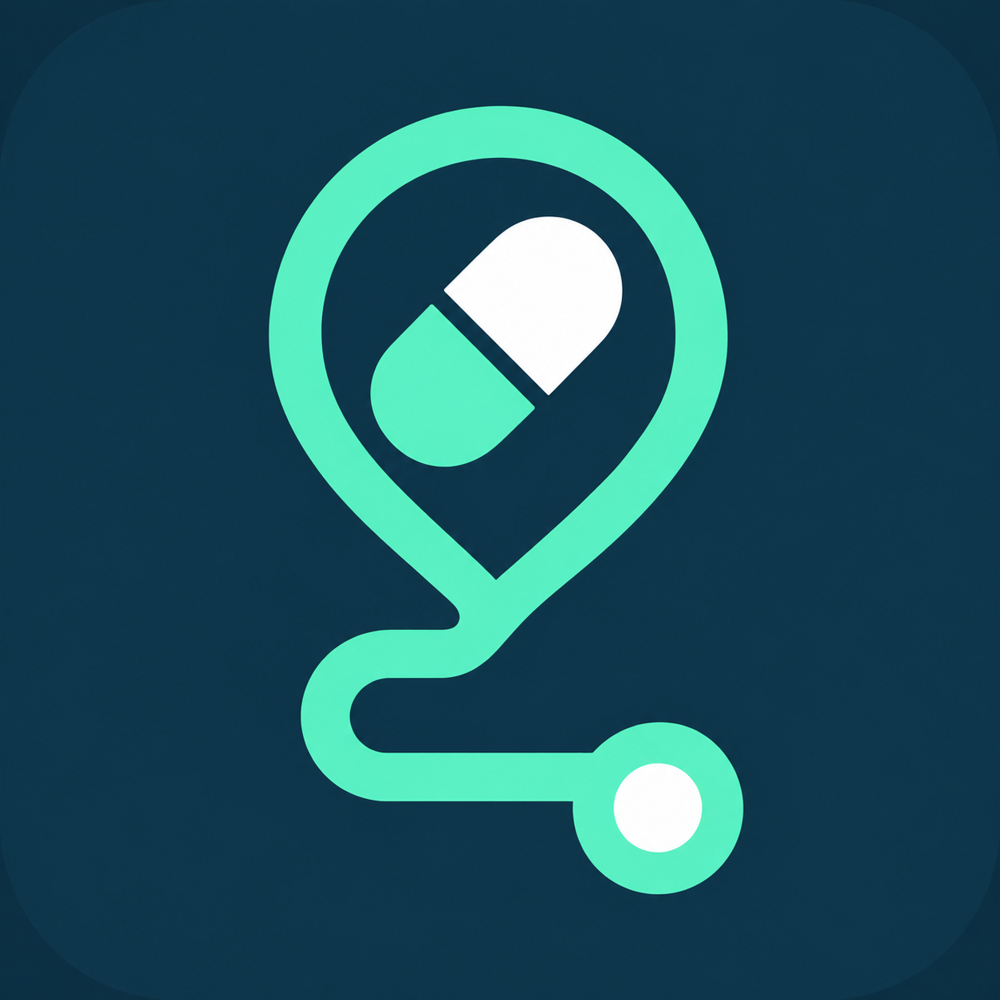
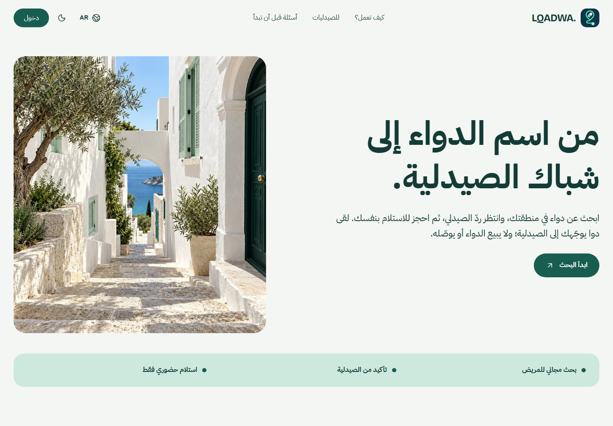
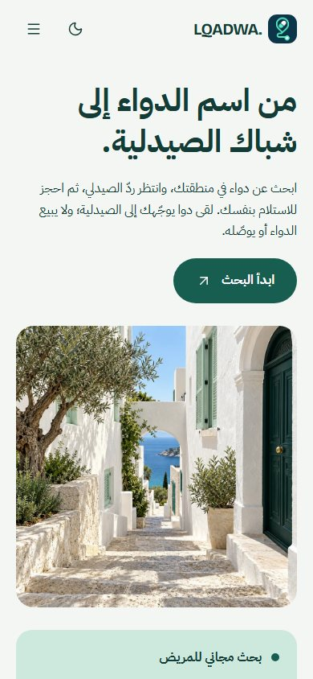
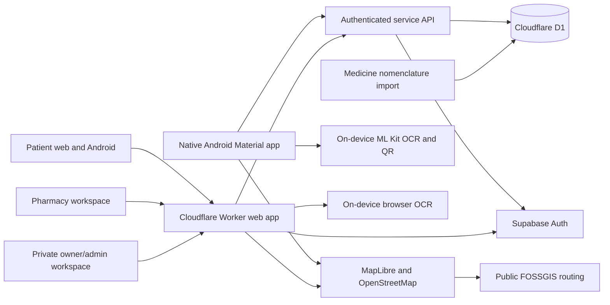

<p align="center">
  
</p>

<h1 align="center">LQADWA · لقى دوا</h1>

<p align="center">Find a nearby pharmacy that confirms availability. Reserve, then collect in person.</p>

<p align="center">
  <a href="https://github.com/AbdelkarimDouadjia/lqadwa/actions/workflows/ci.yml"></a>
  
  
  
</p>

LQADWA is an Algerian pharmacy-orientation service for hard-to-find or urgent medicines. It connects people to registered pharmacies nearby without selling medicine, charging a commission, or arranging delivery.

## Published service

- [Open LQADWA](https://lqadwa.lqadwa-dz.workers.dev/)
- [Browse how it works](https://lqadwa.lqadwa-dz.workers.dev/how-it-works)
- [Pharmacy participation](https://lqadwa.lqadwa-dz.workers.dev/for-pharmacies)
- [Android ARM64](https://lqadwa.lqadwa-dz.workers.dev/downloads/lqadwa-release.apk) · [Android 32-bit ARMv7](https://lqadwa.lqadwa-dz.workers.dev/downloads/lqadwa-release-armv7.apk)

Patients use the service free of charge. Pharmacy access is shown as 300 DA/month, waived through 30 September 2027; billing is disabled. Hosting and the database use the configured free plans, subject to each provider's quotas and terms.

## Product walkthrough

These are real captures of the public Arabic “How it works” page on 18 October 2026. The image is editorial illustration, not a real pharmacy or a stock claim.

<p align="center">
  
  
</p>

## Interfaces and capabilities

| Space | Main tasks |
| --- | --- |
| Patient | Search the medicine catalogue by name/strength and wilaya, request availability, review pharmacy replies, reserve for pickup, show the pickup QR/code, and open walking/driving/transit directions where public map data supports them. |
| Pharmacy | Apply for approval, answer nearby requests, manage manually entered stock notes, handle reservations, and verify pickup at the counter. |
| Owner / delegated admin | Review pharmacy applications, manage accounts and service controls, inspect scoped analytics, update landing-page content, and assign or revoke permission-scoped admin access. The admin route is protected and is not linked from public navigation. |
| Native Android | Native Material screens for search, reservations, map, account, pharmacy operations, OCR review, QR pickup and the new in-app service guide. It is not a WebView wrapper. |

### Trust and service limits

- A pharmacy confirms availability; a catalogue entry or directory listing is not proof of current stock.
- Search results are ordered by distance. The public directory distance is approximate from the wilaya centre until the user signs in and provides location.
- A reservation follows pharmacy confirmation and expires after two hours. The patient goes to the pharmacy and presents the original prescription when legally required.
- There is no online sale, medicine payment, delivery, patient subscription or pharmacy commission.
- The medicine catalogue is a reference list, not clinical advice. OCR text is editable and must be checked with the pharmacist; OCR does not verify a prescription, diagnosis, dose or suitability.
- Browser OCR supports the configured Arabic/French/English models. Native Android OCR currently targets printed Latin text; handwriting and Arabic print are not promised there. Prescription images stay on-device.
- Maps use OpenStreetMap/MapLibre and public FOSSGIS routes. Google Maps opens externally for navigation and available transit modes; there is no live-traffic or complete Algerian transit guarantee.
- Optional arrival sharing is foreground-only, consent-based, time-limited and restricted to the pharmacy for that active reservation.

## Architecture



Authentication is handled by Supabase. Role, pharmacy approval, reservation and admin-permission checks are enforced server-side. Application data is stored in Cloudflare D1. There is no public admin signup, ChatGPT login or shared owner password.

## Repository map

```text
app/                       Next.js routes, API endpoints and page styles
components/                Public site, role workspaces and shared UI
lib/                       Auth, access control, pharmacy discovery and domain logic
db/ drizzle/               D1 schema and migrations
supabase/templates/        Branded signup and password-recovery email HTML
android/app/               Native Android app and isolated UI screenshot test
docs/                      Operations, release evidence and real screenshots
scripts/                   CI checks, OCR, local fixtures and Android release tooling
.github/workflows/         CI and manually triggered Cloudflare deployment
```

Public information pages include how it works, pharmacy participation, safety, pricing, help and privacy in Arabic, French, English and Kabyle. Account/workspace navigation is role-specific; the private owner route is not shown in public menus.

## Run locally

Requirements: Node.js 24, Java 17, Android SDK 36, Android build-tools 35.0.0 and Gradle 8.13.

```sh
npm run install:ci
npm run check
npm run test:discovery
npm run lint
npm audit --omit=dev --audit-level=high
npm run build
npx --no-install playwright install chromium firefox webkit
npm run test:e2e
npm run test:ocr
gradle -p android assembleRelease assembleDebugAndroidTest lintRelease --console=plain --no-daemon
```

Browser/integration checks use isolated local D1 and synthetic identities; they do not write to production. `test:ocr` checks a synthetic printed image. Android instrumentation screenshots are captured by `NativeDesignTest` when a compatible emulator/device is available. None of these checks replaces acceptance on a physical phone.

For local web development, apply migrations to a local D1 database and configure development authentication separately; see [OPERATIONS.md](OPERATIONS.md). Never point synthetic fixtures at production.

## Authentication email setup

The project-owned signup-confirmation and password-recovery templates are in [`supabase/templates`](supabase/templates). They use the LQADWA mark and secure Supabase action link. An operator must paste and save them in Supabase Dashboard, then verify actual inbox delivery; see [the email setup guide](docs/auth-email-templates.md). SMTP/mailbox delivery is not proven by a successful code build.

## Design references

The native map/list hierarchy and concise pharmacy states were informed by [Pharmacy Finder App](https://dribbble.com/shots/6795987-Pharmacy-Finder-App) and [Pharmacy App Concept](https://dribbble.com/shots/6948601-Pharmacy-App-Concept). LQADWA uses its own brand, layout and code; reference artwork and proprietary components were not copied.

## Release and operator notes

- The manual deployment workflow requires a separately configured least-privilege Cloudflare secret. Web and Android CI builds do not sign APKs.
- Signed Android APKs/AAB are produced only from the owner's protected signing material using `scripts/build-android.ps1`. Never commit a keystore or signing password.
- Google/Apple sign-in appears only after each provider is configured and accepted. No Apple developer membership or paid service was purchased.
- Public-map providers, email delivery and free-tier quotas can change; monitor limits before expanding to real users.
- Legal operator identity, pharmacy licenses, data-protection review, physical-device acceptance, email inbox acceptance and fluent Kabyle review remain owner launch responsibilities.

See [RELEASE-CHECKLIST.md](RELEASE-CHECKLIST.md), [RELEASE-HANDOVER.md](RELEASE-HANDOVER.md), [OPERATIONS.md](OPERATIONS.md), [AUTH-PROVIDERS.md](AUTH-PROVIDERS.md) and [BRAND.md](BRAND.md) for full handover details.
