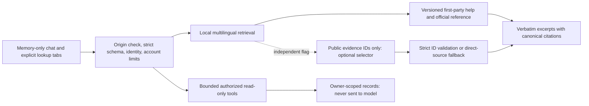

# Grounded service assistant

The separate [conversational assistant](conversational-assistant.md) adds consented generation and a private NVIDIA evaluation route. Its public deployment flag defaults OFF; the NVIDIA trial cannot serve patients. The extractive modes documented below remain available independently.

Owner-managed encrypted credentials are documented in [Assistant provider settings](assistant-provider-settings.md). That integration sends public excerpts only and never falls back to another model/provider when the chosen provider is disabled. The legacy Cloudflare evidence-selector adapter remains isolated; a missing managed key does not trigger a hidden Cloudflare call.

This is a separate, default-OFF module on `/assistant`. It does not establish the core service's legal, email, participating-pharmacy or physical-phone acceptance. It creates no patient requests, reservations, account edits or clinical decisions.

## Implemented modes

- **Retrieval:** local BM25-style ranking of 60 versioned Arabic, French, English and Kabyle service-document chunks, followed by verbatim excerpts and server-owned citations. This is extractive document assistance, not unrestricted generative medical chat. Short explicit follow-ups may reuse the preceding user question; chats stay in component memory, capped at 12 turns, and disappear on reload/clear.
- **Structured reads:** separately selected catalog search/exact medicine ID; up to eight approved pharmacies for a selected wilaya; the authenticated user's latest ten requests and owner-only status. Status includes reply times, stale confirmations, expired reservations, suspended partners and pauses. It never returns pickup secrets or precise arrival locations. Catalog IDs use the same version/index convention as the separate core identity candidate; existing medicine endpoints and native contracts remain unchanged.
- **Optional model evidence selector:** owner-managed OpenRouter `openrouter/free`, disconnected until a current credential is tested and explicitly enabled. It sees only already-retrieved PUBLIC excerpts. It never receives the user's question, history, account facts, medicine lookup results, GPS, images or OCR. Its only accepted output is a strict JSON list of existing evidence IDs, retaining the highest-ranked item. Server-rendered answers remain verbatim source text. Invalid IDs, prose, extra fields or invented citations are rejected.

No embeddings, vector database, remote crawler, uploaded documents, private health notes or external LLM account access are needed for the retrieval mode. This intentionally starts with deterministic help/catalog lookup as required by the master specification. Free-form generated medical answers and model-executed tools are absent.

## Architecture

The tool schema has no account-ID, SQL, arbitrary URL, write operation or model-chosen tool loop. Browser origin checks and the existing authenticated opaque native-session validation apply. The latter does not grant admin access; this endpoint contains no privileged admin reads. Closed/suspended accounts are denied by the shared identity guard. Responses are private/no-store. No prompts or provider exception bodies are logged, and no conversation table is created. Existing hash-only rate counters are the only new persistent state.

## Corpus governance

`lib/assistant-corpus.ts` includes code-reviewed snapshots of first-party service help, account-recovery guidance and one short original paraphrase linking to the official WHO Medication Without Harm page. It contains rights/provenance labels, source dates and stable IDs. Existing CMS content is deliberately excluded: publishing a page does not authorize adding model instructions or a new source to retrieval. Operator acceptance and fluent Kabyle safety review remain separate gates; code review is not professional or legal approval.

`lib/assistant-manifest.json` pins all chunk hashes, the corpus hash and version. To change/remove a source:

1. Verify the source, applicable rights and factual wording; edit/remove its entry. Never ingest real prescriptions.
2. Update the corpus version and actual review date.
3. Run `node scripts/assistant-index.mjs --write`, review the resulting manifest diff, and extend the evaluation fixtures for changed behavior.
4. Run `npm run test:assistant`, `npm run check`, build, integration and browser checks; publish through protected-main review.
5. No vector cleanup is needed. A clean build replaces the complete immutable index. Roll back code and manifest together.

The public page linked by a citation can later be edited independently. The answer includes the actual indexed excerpt, date, ID and content hash so that the document snapshot being cited is explicit.

## Flags, bounds and free services

- `GROUNDED_ASSISTANT_ENABLED`: defaults OFF; only exact server value `true` enables the API/chat. When OFF the help-page entry is absent and the API returns `feature_disabled`. There is no client parameter to enable it.
- `ASSISTANT_EVIDENCE_AI_ENABLED`: independently defaults OFF, and is ineffective while the first flag is OFF. No model is called without a tested, explicitly enabled owner credential.
- With AI OFF: zero model calls/cost. With AI ON: existing D1 counters atomically cap provider attempts to **20 total/day**, including failed attempts, with no provider retry. Maximum public excerpt payload 6,500 characters, maximum output 128 tokens, 2.5-second abort deadline, a shared 60-second failure circuit and direct-source fallback. Model output cannot add text, links or tools. Public index data is cached in module memory; private answers are not cached.
- All assistant requests: 10/minute and 100/day per authenticated account; strict body limit 4,096 bytes, question 400 characters, medicine query 100, at most two previous questions, three help excerpts, bounded tool records. Any platform quota failure falls back rather than switching to a paid model/provider.

The current integration uses the fixed OpenRouter free router with zero price ceilings, no paid fallback, public excerpts only and private-provider restrictions. Other providers support credential authentication checks only. See [Assistant provider settings](assistant-provider-settings.md) for activation, privacy limits, encryption recovery and provider references. No billing plan is changed and no API credits are purchased. The app's limits are not a promise of a provider's permanently free terms.

The old Cloudflare adapter is not an automatic fallback. Do not add an AI binding expecting it to bypass owner configuration. Switching off the external-evidence flag or disabling/removing the owner credential stops new model calls; the read-only assistant continues with direct source excerpts. Switching off the primary flag disables the assistant itself. No record deletion is required.

## Verification and acceptance

`npm run test:assistant` verifies the manifest and runs a reproducible synthetic multilingual retrieval/safety benchmark plus strict-tool, citation-spoofing, prompt-injection, product-strength/form, timeout/cancellation and mocked provider-output checks. Its printed top-1 and recall-at-3 are exploratory retrieval results on the committed cases, not handwriting accuracy, clinical validation or fluent translation approval.

The isolated HTTP/D1 suite verifies two-user isolation, native-token revocation, origin checks, suspension, stale replies, expiry without writes, source/date responses and per-user quotas. Browser checks exercise real local authentication, RTL/language/theme/mobile layouts, keyboard-accessible controls, source expansion, catalog lookup, offline failure/retry and conversation clearing in Chromium/Firefox/WebKit. CI enables both switches with a synthetic encryption master in its isolated local Worker; provider calls in unit tests are mocked and no provider is active in browser fixtures. Fixtures are never deployed.

Before public activation, the responsible operator must record acceptance of the help corpus/privacy wording (including Kabyle), current participating-pharmacy facts and escalation wording, then exercise the signed Android app on a physical phone. Before optional model activation, separately accept provider terms/privacy, run public/synthetic-only model compatibility/quality/latency and quota-exhaustion checks, and verify the free-plan cap/circuit/fallback in that account. No live provider success or patient safety is inferred from mocked calls. Production handwriting recognition remains a separate disabled module.
