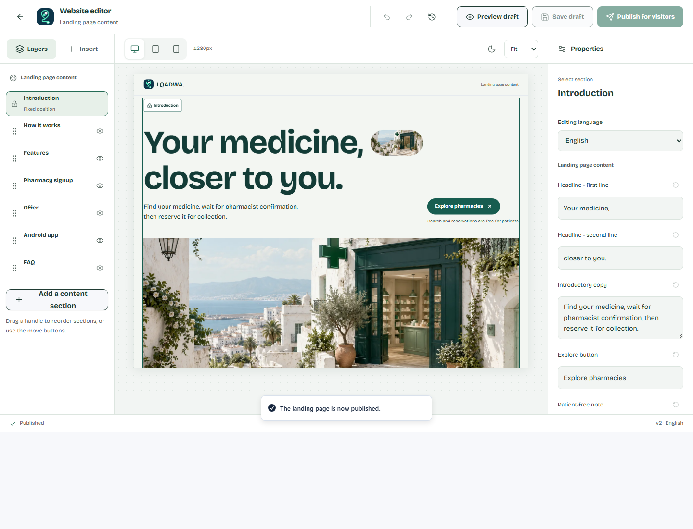

# LQADWA — owner handover

The review branch is `feat/core-release-readiness`, [PR #7](https://github.com/AbdelkarimDouadjia/lqadwa/pull/7). Use its exact-head checks for current verification. The public site remains version 1.1.0 until an approved application deployment. Production migrations 0013/0014 are applied with explicit approval, protected backups and successful restore rehearsals.

## Visual website editor

Capture from an isolated local browser review; the publication toast in this capture refers to that local database, not the production website.

After approved deployment, sign in with your own owner account at `/operations/login`, complete authenticator verification at `/operations/security`, then open `/operations/editor`. Delegated accounts do not receive owner publishing access.

The editor is separate from management tables. The left panel contains layers and section templates, the center shows the actual page, and the right panel edits properties. Select a section on the canvas or in Layers. Drag its handle to reorder it, or use move buttons / Alt+ArrowUp and Alt+ArrowDown. The introduction and automatically populated pharmacy directory keep fixed positions.

Add text or signup sections, edit Arabic/French/English/Kabyle copy, choose alignment and surface color, duplicate or hide sections, and check phone/tablet/desktop widths and both themes. Up to eight custom sections are supported. Undo/redo works before saving. This is a section-based editor; it does not execute arbitrary HTML or scripts.

**Save draft** keeps changes private. **Preview draft** shows the draft without editing overlays. **Publish for visitors** asks for confirmation, saves first, then publishes all locales. Published history can restore a previous version while preserving a separate unpublished draft. A stale version from another tab is rejected instead of overwriting newer work.

**Export draft** downloads a JSON backup of the current canvas. **Import draft** validates a LQADWA draft file (maximum 512 KB), asks before replacing local edits, and supports Undo. Importing never publishes automatically. Keep exported files private if they contain unpublished business copy; never put patient details or prescriptions into landing-page content.

If authentication expires, use **Verify in another tab**, complete MFA there, return to the original editor and retry. The original canvas remains open. If another tab changed the page, export your edits before reloading the latest draft; import only after deciding to replace that draft, then save/publish deliberately. Identical save retries recover the committed draft without adding another audit record. Draft saves and their audit entries commit together.

## Roles and daily use

- Patients: confirmed account, explicit medicine choice, location consent or manual wilaya, availability request, pharmacist reply, reservation and in-pharmacy pickup. Catalog identity never verifies a prescription or guarantees stock.
- Pharmacists: owner-approved pharmacy, current address/pin/hours, staffed request inbox, yes/no replies, stock maintenance and pickup-code verification. Incoming events use database polling; delivered push notifications are not enabled.
- Delegated administrators: their own confirmed account, email-bound invitation, authenticator step-up and only the permissions assigned by the owner. MFA alone grants no role.
- Owner: private administration, pharmacy approval/suspension, account/service controls, scoped management, audit history and visual CMS. Use individual administrator accounts and a documented recovery process.

## Release boundaries

Candidate default is `INFORMATION_ONLY`. CORE workflows require explicit release acceptance; new health-note collection remains off independently. Prescription AI and the grounded assistant stay disabled. Handwriting has not been clinically accepted. The assistant is a structured read-only foundation, without a deployed general-purpose LLM pipeline. iOS remains deferred.

Before publication, complete the exact items in [operator actions](operator-actions.md): legal/operator/privacy/catalog acceptance, real non-team confirmation and recovery email receipt, one verified staffed pharmacy with a live round trip, owner MFA/recovery acceptance, and channel acceptance. Close Supabase signup for an information-only launch while preserving existing sign-in/recovery. A new Android distribution also needs signed fresh-install/upgrade acceptance on a physical phone using the existing certificate. No unsigned APK is a final distribution.

Deployment and rollback follow [the runbook](release-runbook.md). Do not restore an old database over newer patient records to fix an application bug. Current limitations and later work remain explicit in [the backlog](residual-backlog.md). No service was purchased; free hosting does not replace operator or pharmacy acceptance.
