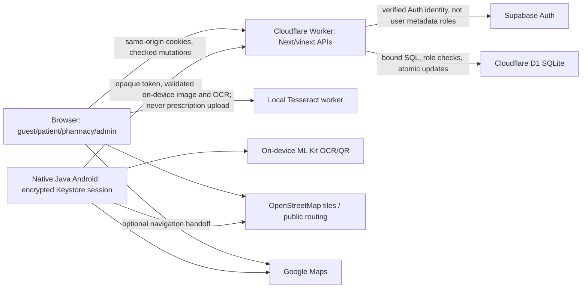
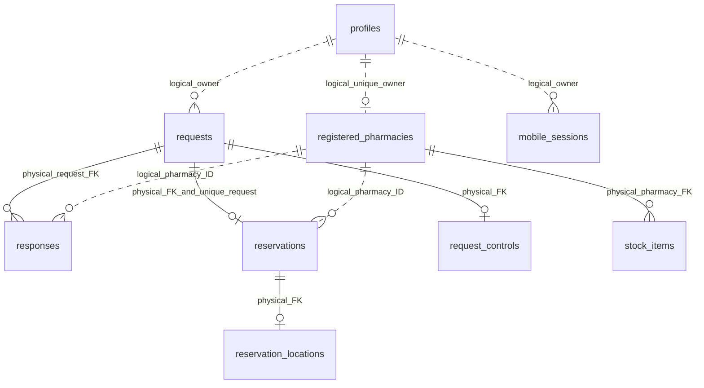

# LQADWA: phase-one engineering and launch audit

13 October 2026. Baseline: `e04c3255b7fed99cf3bb645d535d16e9642a0c6d`. Branch: `codex/phase-one-discovery-audit`.

This is a scoped draft change, not a production-readiness certificate or a penetration test. Production accounts, D1, Supabase settings, providers, deployment, signed downloads and signing custody were not changed. GitHub reports the repository **public**; the owner explicitly chose to leave visibility unchanged. Earlier private-repository statements in the handover are historical.

## First change and boundaries

- Fix recipient discovery independently of the national alphabetical preview cap. Use the existing city/status index, return at most 25 recipients, preserve manual confirmation and the legacy Android JSON shape.
- Add public `GET /api/v1/pharmacies` with validated city/night/radius filters, 1–50 items, stable score/ID cursors, no stock guarantee, and explicit approximate wilaya-center origin. No patient GPS query parameters.
- Keep legacy `/api/app` preview bounded at 300, but append approved public details for returned responses/bookings, at most 400 unique associated IDs in chunks of 90. Full national browsing in the old client is **not** fixed by this adapter; migration to v1 remains a separate slice.
- Public pharmacy SELECTs and serializers use an allowlist; owner/license IDs are not returned. The old serializer already omitted them: this was a scale defect, not a demonstrated public-license leak.
- Simplify the landing hero to one primary patient action, a secondary pharmacy-section link, and the existing localized manual-confirmation reminder. Remove two decorative section labels. Preserve navy/mint, four languages, pricing and pickup safeguards.
- Give each integration run its own local D1 state. Earlier runs reused preview rate-limit counters; the new harness does not clear production protections or the user's preview database.

No migration, new service, paid dependency, public launch, push-provider setup, account change or version/signing change is needed for this PR. Transactional request deduplication, outbox delivery, MFA, canonical medicine IDs, SSR landing and broad redesign are deliberately separate work.

## Evidence register

VERIFIED means source inspected or a stated local test actually ran. INFERRED is a risk needing reproduction. NOT TESTED is not a pass. APPROVAL BLOCKED means an external/production or legal decision is needed.

| Finding | Severity / confidence | Evidence and status |
|---|---|---|
| National alphabetical cap hides eligible wilayas | P1 / verified | Baseline `app/api/app/route.ts` snapshot and search; red regression returned 400 with 350 Oran plus 40 Algiers synthetic records. New selection: `lib/pharmacy-discovery.ts:21`, `app/api/app/route.ts:143`. |
| Legacy clients need recipient-card lookup after selection fix | P1 / verified | Android/web use `snapshot.pharmacies`; bounded adapter in `lib/pharmacy-discovery.ts:31`, snapshot line 76. |
| Email confirmation/recovery acceptance absent | P0 / not tested | `AUTH-PROVIDERS.md`, `RELEASE-CHECKLIST.md`. Owner reported SMTP configured; no fresh dashboard or real non-team delivery evidence. |
| Legal operator, health-data necessity, cross-border/minor/retention obligations unresolved | P0 / approval blocked | `lib/profile-details.ts`, privacy page, legal checklist below. An email address alone is not a legal operator identity. |
| Catalog choice not a canonical server request identifier | P0 / verified | `app/api/app/route.ts` accepts free-text medicine; `/api/medicines` has registration/strength/form. OCR matching is not prescription validity or stock verification. |
| Atomic booking/reply/collection guards already exist | P0 / verified source; race tests in new suite | Conditional updates, unique booking/request index, service/request triggers; `app/api/app/route.ts:163,184`, migrations 0009/0010. Do not report these as missing without evidence. |
| Search UUID dedup check precedes insert | P1 / inferred race risk | `app/api/app/route.ts:138`; two simultaneous identical UUID searches can both pass the read. Needs its own idempotency/notification design and test. Not fixed here. |
| No privileged MFA/step-up, native session rotation absent | P0 / verified absence; approval blocked configuration | `lib/access.ts`, `lib/device-session.ts:5`; native sessions expire after seven days. Rotation/reauth plan below. |
| Full snapshot polling and large client view | P1 / verified | `app/page.tsx:57,91,141` (52,005 source bytes); role snapshots, visibility-aware preference-driven refresh, global one-second clock. Not an unconditionally running background poll. |
| Public landing awaits client auth fetch | P1 / verified | `app/page.tsx`; root server shell is not the complete guest marketing content. Browser DOM showed no canonical link. Metadata alone is not SSR content. |
| Catalog index exists, each query still scans/ranks | P1 / verified | `app/api/medicines/route.ts`; normalized module-level index is already built once, not rebuilt for every query. Versioned canonical index/cache remains pending. |
| Full-repository lint is failing | P1 / verified | Before and after: 55 findings, 29 errors / 26 warnings. Changed slice lint passes; full lint is not currently a required CI gate. |
| CSP is incomplete, not absent | P1 / verified | `public/_headers`, framework response headers: object/base/frame/form restrictions, no restrictive `script-src`. Report-only rollout needed first. |
| Native release optimization/device acceptance incomplete | P1 / verified source / not tested device | `android/app/build.gradle:22` has R8 disabled. Unsigned compile/lint is not physical-device or signed-upgrade acceptance. |
| Main/environment branch protections | P0 / not tested / owner approval blocked | `.github/workflows/ci.yml`, `deploy.yml` use pinned actions, read-only source permission and manual production environment. Actual reviewer/branch protection settings were not inspected or changed. |

## Current architecture and trust boundaries



Coordinates sent to a routing/tiles provider are a separate privacy boundary. External transit coverage is provider-dependent; this project does not own an Algerian train/transit timetable or guarantee live transit. Camera/GPS are optional, with a list/manual input fallback. Native Android is a separate Java application, not a new WebView wrapper. Admin access to the protected web dashboard is not a complete native admin UI.



`db/schema.ts` also defines notifications, admin members/invites, account controls, audit log, device links, rate limits, maintenance, closed-account tombstones and service controls. Dashed relationships are **not** physical foreign keys. Erasure/service integrity therefore also relies on explicit application batches and database triggers, not just cascade deletes.

### Session, role and availability flows

```text
Browser password/provider -> Supabase verified user -> protected cookies -> Worker identity
Android password or one-use linked-device exchange -> random token -> SHA-256 D1 record
  -> encrypted Keystore -> each API validates expiry/suspension/tombstone -> revoke/expiry
Owner IDs (server config) -> all owner permissions
Delegated account -> admin_members permissions -> each API action/read independently checks scope
Public signup metadata -> never grants owner/admin permissions

Verified patient -> availability request -> <=25 approved pharmacies -> pending reply
  -> pharmacist yes/no once -> yes expires for reservation eligibility after 30 minutes
  -> one reservation/request, two-hour TTL -> cancel / expire / code-checked pickup once
Service pause/request stop/pharmacy suspension -> enforce guards, cancel affected active bookings
Optional arrival sharing -> own active booking only -> stale points hidden and cleaned
```

### Compatibility and permission matrix

| Route / actions | Principal and fields | Android contract / change |
|---|---|---|
| `/api/app` GET | Confirmed identity; own requests/replies/bookings/notices; approved public cards; own pharmacy/inbox/stock; scoped admin snapshot | Kept; associated-card adapter added. No public `owner`/`license`, no other patient's pickup code. |
| `/api/app` search/reserve/cancel | Own verified patient identity, server ownership/TTL/pause checks | Same input and JSON shape; indexed bounded search. |
| reply/collect/duty/stock | Approved owning pharmacy; atomic status and collection code checks | Kept. Legacy stock mutation concurrency differs from newer stock API; migrate separately. |
| share-location/read-notifications/profile | Own account or active reservation; explicit location opt-in | Kept. No discovery GPS parameter added. |
| admin review/account/pharmacy edit | Matching pharmacies/accounts permission; protected-owner rules | Kept; hidden navigation is not authorization. |
| admin invites/grants/revocation | Owner only; invite hash, target email, explicit scopes, expiry | Kept. No owner credentials or new grants created. |
| `/api/admin` sections/CRUD | analytics/accounts/pharmacies/operations/audit; service owner-only; paged rows; reasons/audit | Kept. Account scope gets basic optional personal fields, **not** medical notes; review need-to-know granularity next. |
| `/api/profile` GET/POST | Self personal/health/pharmacy details | Kept. Owner sees health only when `shareWithOwner`; pharmacy/delegates never receive medical notes. Owner/basic admin editing cannot rewrite medical consent. |
| `/api/stock` GET/edit/delete | Approved owner; paging and optimistic timestamp | Kept. Stock note is not a guaranteed synchronized POS inventory. |
| `/api/auth`, callback, providers/logout | Validated password/registration/recovery/update/provider operations; approved redirects; provider allowlist | Kept; no ChatGPT provider introduced, no live SMTP/OAuth changes. |
| `/api/device` create/approve/exchange/logout | Challenge/verifier + one-use linking; verified approver; hashed session | Kept; expiry/revocation present, rolling token rotation pending. |
| `/api/account`, deletion-proof | Self export; scoped owner management where supported; local erasure/tombstone; separately verified Auth deletion proof | Kept. Native-only closure may leave Supabase Auth deletion pending; needs operator retry/reconciliation. |
| `/api/medicines`, `/api/health` | Public generic catalog / non-sensitive health | Kept; generic medicine catalog never implies availability/suitability. |
| `/api/v1/pharmacies` GET | Guest approved public directory; hashed-IP limit; no PHI/GPS; no-store; contextual validated cursors | Additive only. No old native binary depends on it. Guest UI integration pending. |

## Threat model and targeted next controls

Assets: identity/session/signing credentials, pharmacy approval/license material, patient medicine requests/pickup codes, optional medical notes, consent-limited location, audit integrity and service availability. Threats: cross-account IDOR, forged client roles, replay, concurrent state transitions, abuse of free endpoints, leaked URLs/logs, compromised privileged account, incorrect pharmacy selection, failed erasure and unsafe deployment.

Existing controls include validated Auth identity, server owner IDs, delegated scopes, hashed native tokens, origin checks, body limits, hashed rate buckets, conditional SQL, tombstones, no public fixture controls, audit reasons and on-device OCR. These are controls, not proof of comprehensive security.

1. MFA proposal: enroll privileged users with Supabase TOTP, recovery procedure first; require **server-side** `aal2` for privileged reads/writes and delegation, not a browser-only gate. Native tokens must bind/recheck a recent elevated authentication grant; an opaque seven-day token must not bypass step-up. Deny rather than silently downgrade. Requires provider/owner acceptance and staging bypass tests. [Supabase MFA guidance](https://supabase.com/docs/guides/auth/auth-mfa).
2. Native rotation proposal: short access lifetime + one-use rotating refresh family, reuse detection, hashed storage, idle/absolute expiry, force-revoke on privilege/account changes, recover safely after process death. Preserve signing identity and versioned linking protocol. No token protocol changed in this PR.
3. CSP proposal: staging `Content-Security-Policy-Report-Only`; inventory Next/Vite scripts, inline/nonces, OCR workers/WASM/language files, tiles/routing and Supabase. Redact report URLs, prohibit PHI bodies, resolve violations before enforcement. Test workers/maps/OCR/login on mobile. No blind restrictive CSP deployment.
4. Incident runbook: operator on-call/contact, contain affected scopes/sessions with existing controls, preserve redacted evidence, determine data and jurisdiction exposure, involve counsel for notifications, recover from verified backup, reconcile queues/deletion, record corrective actions. Do not automatically email users or regulators from an audit.
5. Release controls proposal: required reviewed PR and web/Android checks, CODEOWNERS after owner chooses reviewers, least-privilege deploy token, staging separation, protected production reviewers, secret/dependency scanning where free plan permits. Do not invent protection settings or paid-plan availability.

## Launch blockers requiring acceptance

### Email and authentication

Use a real non-team mailbox only with operator permission; do not publish that address in evidence. Test registration confirmation delivery, callback returning to the intended workspace, resending/rate limits, expired/reused/tampered links, unknown-email recovery without enumeration, reset completion with all sessions revoked where intended, bounce/provider failure and support recovery. Record UTC timestamps, result and provider reference without passwords, OTPs or links. Free sender quotas and Gmail deliverability are not accepted simply because settings save.

### Legal/privacy review, not a compliance opinion

An Algerian reviewer should confirm the legal operator and public contact, pharmacy orientation/pickup terms and license verification procedure, lawful basis and necessity of each field, minors/guardian flow, sensitive-health handling, cross-border vendors and agreements, regulator formalities, retention by entity, rights/erasure exceptions, incident notification and operational pharmacy responsibilities. Review Law 18-07 **with its 2025 amendment**, rather than treating the original as the entire current framework. [Official Justice index](https://droit.mjustice.gov.dz/fr/content/protection-des-personnes-physiques-dans-le-traitement-des-donn%C3%A9es-%C3%A0-caract%C3%A8re-personnel), [2025 Official Journal](https://www.joradp.dz/FTP/jo-francais/2025/F2025048.pdf), [Ministry legal-text index](https://miph.gov.dz/%D9%85%D8%B5%D9%86%D9%81-%D8%A7%D9%84%D9%86%D8%B5%D9%88%D8%B5-%D8%A7%D9%84%D9%82%D8%A7%D9%86%D9%88%D9%86%D9%8A%D8%A9-%D8%A7%D9%84%D8%AE%D8%A7%D8%B5%D8%A9-%D8%A8%D9%88%D8%B2%D8%A7%D8%B1%D8%A9-%D8%A7-2/).

Recommendation: stop expanding health-note collection; first determine whether orientation requires it at all. Optional, private and consented does not itself establish necessity or legal compliance. Propose removing collection if unnecessary, while separately agreeing lawful retention/erasure of existing data. This audit does not erase live records or unilaterally disable existing accounts. Home address, age and profession should be optional and purpose-limited; avoid exact birth date when age-band would suffice. Kabyle medical/legal terminology requires a qualified fluent human, not a model's self-certification.

### Android and operational safety

On physical supported phones: fresh install and signed upgrade, offline/reconnect, confirmation/recovery return, expired/revoked sessions, camera/gallery and denied permissions, GPS disabled, map/list fallback, directions mode handoff, QR replay/expiry, OCR review/strength selection, rotation/process death, TalkBack/large text/reduced motion and privacy on lock screen. Record device/OS/build, not patient data. Keep the original signing certificate; create an owner-held **encrypted portable recovery backup** and rehearse restoration securely before relying on Windows-bound DPAPI alone. No keystore was opened or regenerated here.

## Ordered implementation backlog

Effort is relative: S = one reviewable slice, M = several coordinated slices, L = provider/legal/field work. Criteria are targets for acceptance, not current measured success.

| Priority / effort | Change and user impact | Acceptance / dependencies / risk |
|---|---|---|
| P0 / M | Non-team SMTP confirmation/recovery acceptance | Delivery/expiry/reuse/rate/bounce tests recorded; operator setup and mailbox approval; high account-access risk. |
| P0 / L | Operator/legal/privacy/retention/minors and health necessity | Signed-off disclosures, field purposes, vendors, rights/incident procedure; counsel/operator; high sensitive-data risk. |
| P0 / M | Canonical medicine ID + explicit unmatched state | Server resolves registration/form/strength; selection reviewed; no auto-substitution; native additive contract/catalog provenance. |
| P0 / M | MFA/step-up for privileged APIs including native | No AAL1/native bypass; recovery tested; owner/Supabase approval; high lockout/access risk. |
| P0 / M | Erasure reconciliation + signing restore/device acceptance | Native/Auth deletion retries verified, tombstone retained lawfully; portable encrypted key restoration/physical-phone checklist accepted; owner custody. |
| P0 / S–M | Reviewed main/protected release pipeline | Required checks/review, scoped deploy credentials, protected staging/production confirmed; owner/GitHub plan approval. |
| P1 / S | Discovery cap and additive pagination (this PR) | >300 rows, 25 recipients, public allowlist, stable cursors, legacy detail lookup; existing indexes; no migration. |
| P1 / M | Idempotent request service/outbox | Concurrent UUID replay creates exactly one request/recipient notice; cancellation/expiry/approval checked transactionally; retry/dead-letter design; additive staging migration approval. |
| P1 / M | Snapshot/domain/role decomposition | Narrow loaders + typed compatibility adapter; conditional polling/push proposal; per-role fetch cost measured; installed Android supported. |
| P1 / M | Versioned catalog query index | Authoritative ID/strength/form, Arabic/French normalization tests, bounded query/cache, matched/unmatched labels; source-refresh ownership. |
| P1 / M | SSR guest discovery/SEO + landing/navigation | Public content in initial HTML, approved directory usable without signup, protected routes noindex, factual canonical/hreflang/sitemap; no invented listings. |
| P1 / M | Journey UI and accessible composition | 8 widths × 4 locales × 2 themes, reduced motion, keyboard/axe/screen-reader, errors and map fallback; screenshots and honest CWV; see design plan. |
| P1 / M | Full lint/E2E/observability/privacy | Clean lint before required gate; cross-browser fixtures; redact events and define counters; staging limits and alerts; no medicine/location in analytics. |
| P1 / M | Session rotation/CSP/report-only/R8 evaluation | Security/recovery/provider constraints tested; physical/native regressions; stage before enforcing or changing signed release. |
| P2 / L | Pharmacy teams/import/POS integration | Propose scopes, audit receipts, contracts and opt-in pilot first; do not ship free-text inventory as live guarantee. |
| P2 / L | Privacy-safe opt-in push/demand alerts | Provider/privacy approval, generic lock-screen text, unsubscribe; no disease inference or clinical reminders by default. |
| P2 / L | Brand domain/verified case studies/regional partnerships | Operator buys only if approved; documented licenses/consent/ROI; never sponsored safety ranking. |

## Measurement and verification

Detailed design/skill evidence is in [phase-one-design.md](phase-one-design.md). Command results and final integration status are in [phase-one-verification.md](phase-one-verification.md). Local ignored artifacts are under `.cloudflare/phase-one/`; no real user/prescription evidence is committed.

Local Node 24.19.0 in-memory SQLite benchmark, 10 warm-up / 100 timed runs, five synthetic scales. Existing city/status and status/name indexes are represented. Times vary with this Windows host's load and exclude Auth, network, serialization, rate limits, snapshot and notification cost. This is **not** a D1 performance or billing claim.

| Total pharmacies | Selected city | Before → after recipients | Before p95 ms | After p95 ms | Traversal pages (50; final empty page for exact multiple) |
|---:|---:|---:|---:|---:|---:|
| 10 | 2 | 2 → 2 | 0.305 | 0.667 | 1 |
| 100 | 20 | 20 → 20 | 3.054 | 1.419 | 1 |
| 300 | 60 | 25 → 25 | 2.343 | 0.622 | 2 |
| 1,000 | 200 | 0 → 25 | 1.333 | 0.625 | 5 |
| 10,000 | 2,000 | 0 → 25 | 1.265 | 2.009 | 41 |

The old query is sometimes faster because it returns a capped, **wrong** set. New distance ordering still sorts all eligible city candidates with a temporary B-tree; it is not O(1) or a spatial index. EXPLAIN confirms a city/status index search. Further spatial/radius optimization requires measured city distribution and staged indexes, not an invented speedup.

Fan-out remains 1 request + 25 responses + 1 patient notice + 25 pharmacy notices = **52 insert statements** at 25 recipients; profile initialization adds one statement. Removal of the pre-selection snapshot replaces three mutation statements + eleven snapshot data queries + role/service reads with one candidate query and one profile-init statement. The final compatibility snapshot still executes. Statement counts are source-derived, **not** measured rows written or billed savings. Per-search D1 billed rows/cost, queue lag, hosted p50/p95, CWV and concurrency load capacity remain unmeasured. Local CLI metadata, if exposed, is labelled local and cannot establish production billing. Before any free-plan capacity promise, stage a reproducible 25-recipient search load with complete endpoint timings and D1 metrics; compare current official provider quotas at that time.

## Migration, rollback and rollout

No schema migration is introduced. Existing `idx_registered_pharmacies_city_status` / `idx_pharmacies_status_name` support filtering. No live backup or database export was performed for this non-production change. Test migrations run only in a newly created local integration directory; failed directories are retained for diagnosis, not published.

Rollback is an app-code revert/redeploy of the previously accepted version, with **no destructive schema rollback**. It restores the old discovery defect, so do not use rollback as an excuse to expand beyond accepted geography. The additive endpoint can be removed only after checking consumers. Before approved deployment: independent staging, compatibility smoke with installed Android, backup/restore rehearsal for any future schema change, redacted logs, owner sign-off and health checks. Keep paid services and store submission disabled unless explicitly approved. This draft PR must not auto-merge or auto-deploy.

## 30 / 60 / 90-day pilot

| Period | Operational work | Exit evidence |
|---|---|---|
| Days 1–30 | Close P0 operator/email/safety/security acceptance; one agreed locality; verify every pharmacy identity/pin/hours; observe consented patient/pharmacist journeys and failure recovery | Actual onboarding records, small-cohort usability notes, delivery/device acceptance, response/pickup baselines; no invented target pharmacy count or public claims. |
| Days 31–60 | Roll out narrow endpoints and measured notification reliability; simplify pharmacy inbox/stock, guest discovery and map/list; review workload and unfilled requests weekly | Defined latency denominators, actual successful pickups, privacy-safe incident counts, repeat-use interviews; expand only when coverage/response support it. |
| Days 61–90 | Compare opt-in regional cohorts, retention/workload and support burden; decide sustainable operations and partnership scope | Real week-4 retention, weekly-active verified pharmacies, recorded reasons for no response/cancellation/expiry; operator/legal approval before new region/provider. |

Metrics definitions: activation = first valid request / verified signups in cohort; response latency = reply timestamp minus request timestamp (report nonresponses separately); confirmation rate = requests with a fresh yes / valid requests; pickup completion = collected / reservations with elapsed outcome window; pharmacy workload = sampled weekly active handling time (consented measurement, not guessed from counts); week-4 retention = activated cohort returning in week four; weekly-active pharmacy = approved pharmacy with real reply/stock/pickup activity; support incidents = categorized events with no medication/diagnosis in analytics. Use coarse aggregated counters, restrict small-cohort reporting and agree retention; these analytics are **not newly installed** by this PR.

Patients' core search/reservation remains free. Listed pharmacy price is **300 DA/month, waived until 30 September 2027**, with no payment collection now. Revenue scenario after the waiver is `paying verified pharmacies × 300 DA`, before taxes/provider/support costs, not a forecast or commission on medicine. No sponsored pharmacy ranking, checkout, delivery or invented ROI. Pricing changes require measured value and owner/legal review.
